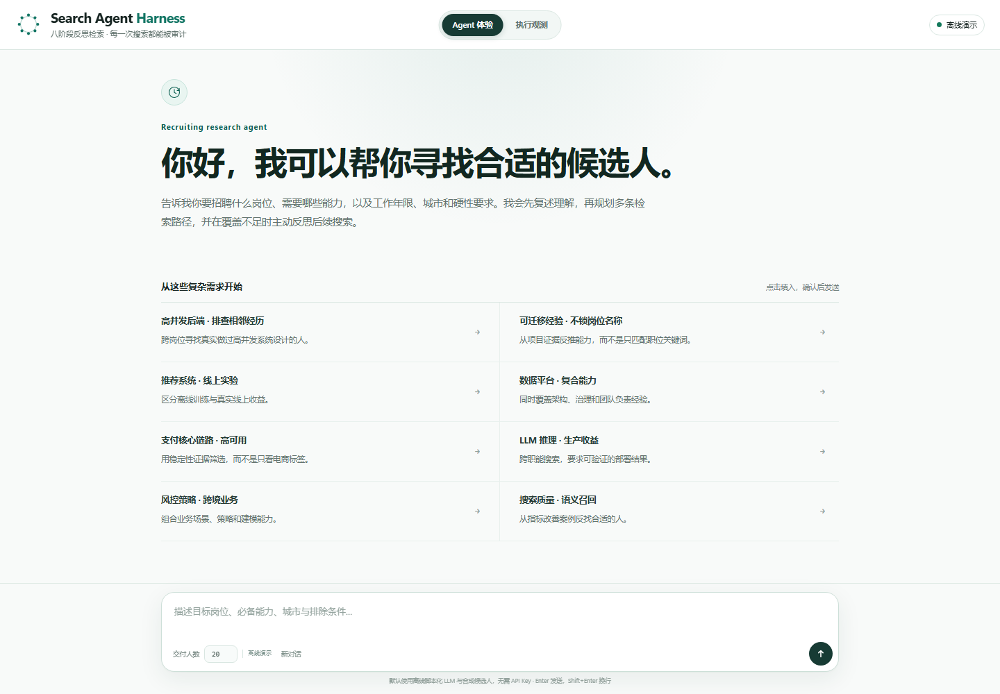

<div align="center">

# Search Agent Harness

**Turn talent search from a one-shot query into a budget-aware search-policy loop.**

Controlled direct search · Adaptive reflection for harder requests · Evidence-grounded judgment · End-to-end observability

[简体中文](README.md) · [English](README.en.md)

[](https://github.com/12wa2/search-agent-harness/actions/workflows/ci.yml)




</div>

> An adaptive Search Agent for talent search: explicit constraints are first parsed into retrieval IR by Hybrid V2 and then executed through a controlled direct-search path; requests that need capability judgment use a lightweight agent; complex requests add multi-path planning, evidence-grounded judgment, and reflective revision inside a budget-governed loop. The project includes a zero-API-key demo and supports real LLMs and Elasticsearch 8.

[Quick start](#quick-start) · [Execution model](#execution-model) · [Evaluation](#evaluation-snapshot) · [Core design](#core-design) · [Documentation](#documentation)

---

## Why this project

The project starts from a concrete mismatch: a job description states abstract abilities such as "high-concurrency system design", while a resume describes concrete projects such as order, payment, or distributed systems. The same ability can come from completely different roles, industries, or product lines; conversely, different titles may hide transferable experience. Keyword search naturally misses candidates in this gap.

I started with NL2IR, trying to make the "natural language → retrieval IR" step accurate. But there is a ceiling: **no matter how accurate the parser is, it only translates one sentence into one query.** The conventional pipeline `NL → IR → ES retrieval → LLM reranking → response` is one-shot: if the first constraints are too strict or the direction is wrong, the system does not revise based on the results, and no stage answers "are these candidates enough, and do they cover the must-have abilities?"

Retrieval is not the bottleneck — Elasticsearch is already strong. The missing layer is **search-policy decision-making**: what to search, where to search, whether the result is sufficient, and when to change direction. In one sentence: **the problem is not retrieval; it is that no one owns the decision of how to search.**

Around that policy layer, the project focuses on three questions:

- When one path is not enough, should the system broaden it, change sources, or stop?
- Is the model judging evidence from the candidate record, or being misled by keyword similarity?
- What does reflection buy in quality, and what does it cost in tokens and latency?

Search Agent Harness adds a controlled policy loop on top of deterministic retrieval. LLMs handle understanding, planning, judgment, and reflection. The engineering layer owns state transitions, budgets, signature deduplication, stopping conditions, cancellation, and degradation. Any retrieval system can plug in through the two-method `SearchTool` protocol.

## Highlights

- **Adaptive execution**: structured requests use a 3-stage direct path; clear requests use a 5-stage lightweight agent; complex requests may use the 8-stage reflective loop.
- **Evidence first**: the judge consumes candidate facts returned by the search tool; cards expose matched abilities, gaps, hard constraints, and source paths.
- **Governed loop**: explicit state machine, iteration/path/LLM/token/wall-clock budgets, signature deduplication, and stage-level degradation.
- **Observable and conversational**: SSE stage events, actual executed stages, raw trace, L1 recent context, L2 conversation archive, and L3 candidate exclusion.
- **Pluggable and reproducible**: in-memory, SQLite/FTS5, Elasticsearch, and Hybrid V2 share one contract; 525 tests and a zero-key demo run locally.

## Execution model

```text
Natural-language request
        |
        v
IntentRouter --- greeting / identity / help / explicit out-of-scope ---> reply
        | SEARCH
        v
Difficulty routing
        |-- structured --> Hybrid V2 parser -> CandidateSearchIR -> SearchTool
        |                   direct_search -> execute -> finalize
        |
        |-- clear ------> understand -> execute -> judge -> evaluate -> finalize
        |
        '-- complex ----> understand -> plan -> execute -> judge -> evaluate
                           -> reflect -> revise -> finalize

Every run: budget checks · signature deduplication · stage degradation · cancellation · trace
```

| Route | Actual stages | Typical request |
|---|---|---|
| Direct search | `direct_search → execute → finalize` | Structured skills, title, tenure, or city |
| Lightweight agent | `understand → execute → judge → evaluate → finalize` | Clear request that still needs judgment and coverage checks |
| Reflective agent | `understand → plan → execute → judge → evaluate → reflect → revise → finalize` | Open-ended preferences, transferable experience, abstract abilities |

The full 8-stage reflection sequence has two budget presets: `reduced` and `standard`. Both execute the same stages, but `reduced` defaults to at most one iteration with two paths per iteration, while `standard` uses the full reflection budget. The SSE events, not the eight-stage navigation, are the source of truth for stages actually executed.

The direct route skips the Agent understanding, planning, judging, and reflection stages, so **Agent LLM calls are 0**. The Hybrid V2 parser still typically makes one model call and explicitly falls back to local rules on failure. See [Intent Routing](docs/INTENT_ROUTING.md) for the complete policy.

## Quick start

### Zero-key demo

Requires Python 3.12+.

```bash
git clone https://github.com/12wa2/search-agent-harness.git
cd search-agent-harness
python -m venv .venv
```

Windows:

```powershell
.venv\Scripts\activate
pip install -e ".[api]"
search-agent serve --offline
```

macOS / Linux:

```bash
source .venv/bin/activate
pip install -e ".[api]"
search-agent serve --offline
```

Open <http://127.0.0.1:8000>. The quick demo uses a scripted LLM and 16 fictional candidates. It sends no external model requests and does not require Elasticsearch.

Windows can also use the launcher:

```powershell
.\scripts\start-dev.cmd
```

The launcher loads `.env` and prepares the local gateway when a model key is available. The page still starts in quick-demo mode and can switch to the full online preset from the top bar.

### Full online mode

Full online mode needs an OpenAI-compatible model endpoint, Elasticsearch 8, and optionally Redis. Without Redis, conversations and result pagination fall back to process memory.

```powershell
pip install -e ".[api,openai,es,redis]"
docker compose up -d elasticsearch
Copy-Item .env.example .env
# Fill in the model endpoint, key, model name, and Elasticsearch settings.
$env:SEARCH_AGENT_HYBRID_V2_ES_URL = 'http://127.0.0.1:9200'
$env:SEARCH_AGENT_HYBRID_V2_ES_INDEX = 'search-agent-demo'

search-agent hybrid-v2 index --recreate
search-agent hybrid-v2 doctor
.\scripts\start-dev.cmd -StartOnline
```

Running `search-agent ...` directly does not load `.env`. The `$env:` lines above only export the Elasticsearch endpoint and index name needed to build the index. If `.env` changes embedding, model, or other Hybrid V2 settings, export those variables into the current shell first as described in [Deployment](docs/DEPLOYMENT.md). `start-dev.cmd -StartOnline` loads `.env` automatically.

See **[Deployment](docs/DEPLOYMENT.md)** for the full Docker stack, Redis setup, and troubleshooting. See **[Configuration](docs/CONFIGURATION.md)** for every environment variable.

## Interface

The default view is a conversational agent workspace: recent conversations on the left, requirement parsing and live execution evidence in the center, and the delivered shortlist on the right. The sidebar can collapse into a narrow rail with a vertical Expand conversations control, then restore the full list when clicked. Narrow screens use a drawer for the same sidebar and keep a conversation entry in the top bar. Another top-bar switch opens the execution-observability view with actual stages, retrieval paths, metrics, and raw trace. Both views share the same SSE run and switching does not rerun the search.

[Delivered candidates](docs/console-run.png) · [Execution observability](docs/console-observe.png)

## Evaluation snapshot

The repository keeps two public evaluation tracks:

- the real-LLM A/B in this section: 100 synthetic candidates, 10 complex queries, and top-5, used to observe quality and cost of the reflection loop;
- the CI Oracle/ablation gate: 120 synthetic candidates, Seed 7, and top-10, used to validate mechanism contributions and prevent regressions.

The two datasets serve different purposes and do not replace each other. Real-LLM experiments vary with model version, serving implementation, and generation randomness. The numbers are engineering measurements only, not production-environment claims.

Real LLM + Hybrid V2 A/B (100 V2-native synthetic candidates, 10 complex queries, top-5): the baseline and Agent share the client gateway alias `search-agent-primary`, Hybrid V2, and Elasticsearch; the only structural variable is the reflection loop. Historical artifacts recorded only the client alias, not the per-call upstream model or fallback state; the repository's example gateway configuration cannot be used to infer the model used in the experiment. The figures below are the latest run on 2026-10-21.

| Metric | Single pass | Agent reflection |
|---|---:|---:|
| Mean pool recall | 0.788 | 0.875 |
| Mean Recall@5 | 0.334 | 0.425 |
| Mean Precision@5 | 0.660 | 0.820 |
| LLM calls | 20 | 65 |
| Tokens | 113,495 | 412,812 |
| p50 latency | 25.5 s | 86.7 s |

- The bootstrap 95% CI for pool recall is `+0.004 to +0.170` and excludes zero; Recall@5 improves by `+0.092`, but its interval `-0.001 to +0.194` crosses zero, so 10 queries show an observed gain rather than a statistically established one.
- The Agent delivered 21 new candidates, 14 of them relevant (0.667); LLM calls are about 3.25x and tokens about 3.64x the baseline, p95 latency moves from 32.2 to 116.0 s, and none of the 10 queries hit a budget stop.
- Not every query improves: `stability_capacity` drops from 0.500 to 0.375 and `microservice_backend` from 0.250 to 0.188; `payment_distributed_tx` raises final Recall from 0.062 to 0.250 even though its pool recall falls from 0.562 to 0.438.
Full tables, confidence intervals, and per-query failure analysis are in **[Evaluation](docs/EVALUATION.md)**.

## Core design

- **Adaptive harness**: stages are pure functions behind an explicit loop; an optional LangGraph runner compiles the same stages without changing behavior.
- **Budgets and degradation**: the state machine governs five resource classes—iterations, search paths, LLM calls, tokens, and wall-clock time—and handles covered stage failures through degradation or an explainable termination.
- **Conversation tiers**: L1 injects recent structured context, L2 persists the complete conversation, and L3 records viewed or explicitly excluded candidates.
- **Retrieval boundary**: implement the two methods below to connect your own search system without changing Agent stages.

```python
class SearchTool(Protocol):
    def search_with_intent(self, req: SearchToolRequest) -> SearchToolResult: ...
    def rerank_pool(self, req: RerankToolRequest) -> SearchToolResult: ...
```

See [`examples/custom_backend.py`](examples/custom_backend.py) for a minimal implementation, plus [Architecture](docs/ARCHITECTURE.md) and [Hybrid V2](docs/HYBRID_V2.md) for details.

## Documentation

| Document | What it covers |
|---|---|
| [Intent Routing](docs/INTENT_ROUTING.md) | Five intents, 3/5/8 route selection, and observable fields |
| [Architecture](docs/ARCHITECTURE.md) | State machine, budgets, degradation, merging, and finalize |
| [HTTP API](docs/API.md) | Search, SSE, conversations, candidate exclusion, and pagination |
| [Deployment](docs/DEPLOYMENT.md) | Quick demo, full local online mode, Docker Compose, and troubleshooting |
| [Configuration](docs/CONFIGURATION.md) | Model, gateway, Redis, budgets, ES, and Hybrid V2 variables |
| [Evaluation](docs/EVALUATION.md) | Real-LLM top-5 A/B, intervals, and limitations |
| [Hybrid V2](docs/HYBRID_V2.md) | NL2IR, ES mapping, BM25/kNN, embeddings, and reranking |
| [LLM Gateway](docs/LLM_GATEWAY.md) | Model aliases, fallback routing, authentication, and usage |
| [Case Study](docs/CASE_STUDY.md) | Stage-by-stage walkthrough of a complete query |
| [Decisions](docs/DECISIONS.md) | ADR-style trade-offs and alternatives |
| [Technical Roadmap](docs/ROADMAP.md) | Open engineering hypotheses, validation plans, and trade-offs |
| [Contributing](CONTRIBUTING.md) | Development setup, tests, and extension points |
| [Changelog](CHANGELOG.md) | Implemented capabilities and behavior changes |

## Quality and scope

- The suite currently contains 525 tests; a local run with Elasticsearch reports `525 passed`, and CI runs the integration cases in a dedicated job.
- CI covers Ruff, pytest, Web asset validation, a demo smoke test, an evaluation gate, and Elasticsearch integration tests.
- The repository is not deployed to production and contains no real resumes, company data, internal hosts, or credentials. Demo data is synthetic.
- Model quality, cost, and latency vary by provider; rerun the evaluation before connecting real data.

## License

[MIT](LICENSE)
