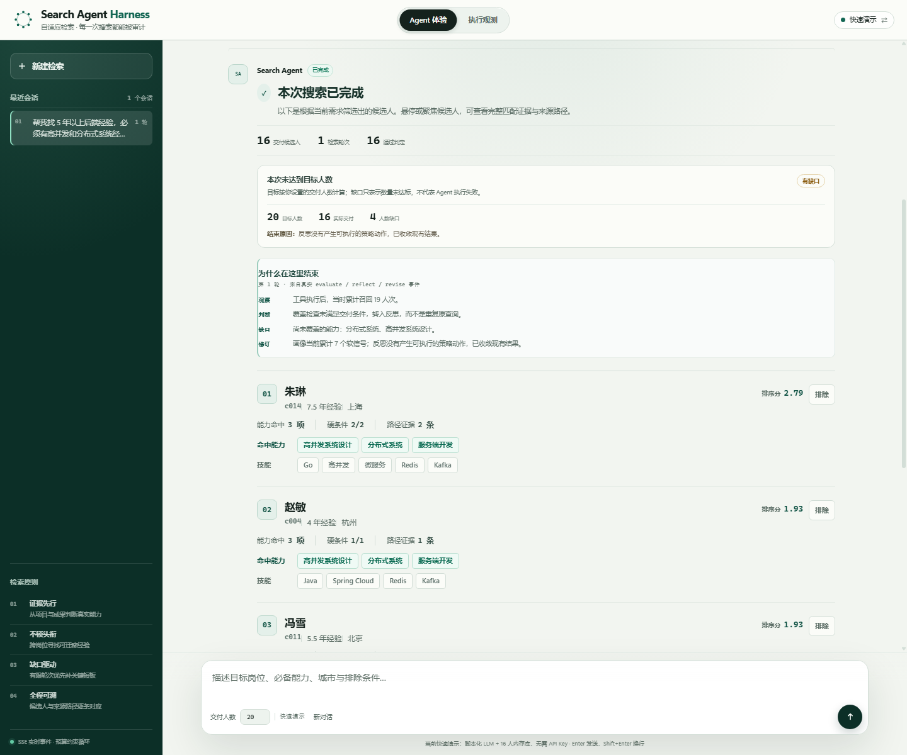
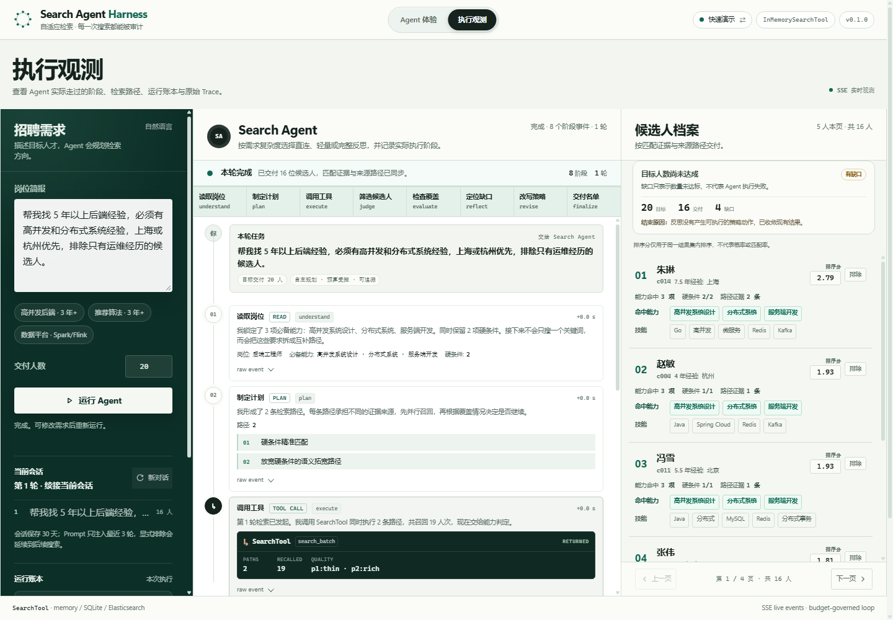

<div align="center">

# Search Agent Harness

**把人才搜索从“一次查询”升级为“有预算的搜索策略循环”**

明确条件直连 · 复杂需求自适应反思 · 证据驱动判断 · 全链路可观测

[简体中文](README.md) · [English](README.en.md)

[](https://github.com/12wa2/search-agent-harness/actions/workflows/ci.yml)


</div>

> 一个面向人才搜索场景的参考实现：明确条件直接走检索 IR；需要判断时走轻量 Agent；复杂需求才进入多路径规划和反思修订。项目自带零 Key 离线演示，同时支持真实 LLM、Hybrid V2 和 Elasticsearch 8。

[快速开始](#快速开始) · [工作方式](#工作方式) · [实测结果](#实测结果) · [接入检索后端](#接入自己的检索后端) · [文档导航](#文档导航)

---

## 它解决什么问题

招聘搜索的难点通常不是“ES 会不会排序”，而是另一层决策：

- 自然语言里的岗位、能力、年限和排除项，应该怎样变成可执行检索条件？
- 一条路径召回不够时，应该放宽条件、换来源，还是承认当前结果已经足够？
- 模型判断的是简历里真实存在的证据，还是只被关键词相似度误导？
- 多轮对话里，哪些条件应该继承，哪些候选人已经被招聘者明确排除？
- 反思能带来多少效果，代价是多少 token、延迟和降级风险？

Search Agent Harness 在确定性检索之上增加一层受控的搜索策略循环。LLM 只负责理解、规划、判断和反思；状态流转、预算、签名防重、终止条件和降级由工程层控制。底层检索通过 `SearchTool` 协议接入，不需要重写 Agent。

这个仓库不是通用聊天机器人，也不是“让模型自由搜索”的演示外壳。它更关注三件事：**什么时候该深入搜索、怎样证明结果够用、每一步为什么这样走**。

## 核心能力

| 能力 | 实现 |
|---|---|
| 自适应执行 | 结构化 `3` 阶段直连；明确需求 `5` 阶段轻量 Agent；复杂需求最多 `8` 阶段反思 |
| 受控循环 | 显式状态机、单次请求预算、迭代上限、路径上限、墙钟与 token 记账 |
| 证据优先 | Judge 读取工具返回的候选人事实；候选人卡展示命中能力、缺口、硬条件和来源路径 |
| 可观测性 | SSE 阶段事件、实际执行阶段、SearchTool 调用、运行指标和原始 Trace |
| 多轮会话 | L1 最近上下文、L2 会话归档、L3 候选人排除；Redis 可选，未配置时进程内降级 |
| 可插拔检索 | 内存、SQLite/FTS5、Elasticsearch 简版、独立 Hybrid V2 四个后端共用同一契约 |
| 容错与取消 | 阶段级降级、LLM 重试、主备网关；客户端断开后在阶段边界协作取消 |
| 零 Key 演示 | 脚本化 LLM + 16 个虚构候选人；不连接模型和 Elasticsearch 也能跑完整 UI |

## 工作方式

```text
自然语言输入
     │
     ▼
IntentRouter ─── 问候 / 身份 / 帮助 / 明确无关任务 ───> reply
     │ SEARCH
     ▼
难度判断
     ├── 结构化条件 ──> Hybrid V2 parser -> CandidateSearchIR -> SearchTool
     │                   direct_search -> execute -> finalize
     │
     ├── 清晰需求 ────> understand -> execute -> judge -> evaluate -> finalize
     │
     └── 复杂需求 ────> understand -> plan -> execute -> judge -> evaluate
                        -> reflect -> revise -> finalize

每次执行：预算检查 · 签名防重 · 阶段级降级 · 可取消边界 · 全程 Trace
```

三条搜索路径共享同一套模型、工具、预算和可观测层，只是按需求复杂度启用不同阶段。

| 路径 | 实际阶段 | 适合什么请求 |
|---|---|---|
| 直连搜索 | `direct_search → execute → finalize` | 技能、岗位、年限、城市等结构化条件明确 |
| 轻量 Agent | `understand → execute → judge → evaluate → finalize` | 需求清楚，但仍需能力判断与覆盖检查 |
| 完整反思 | `understand → plan → execute → judge → evaluate → reflect → revise → finalize` | 开放式偏好、抽象能力、可迁移经验或需要多路径探索 |

直连路径不运行 Agent 的理解、规划、判断与反思阶段，Agent 编排 LLM 调用为 `0`；Hybrid V2 parser 仍通常调用 `1` 次模型，失败时回退到本地规则。

## 快速开始

### 零 Key 体验

要求 Python 3.12+。

```bash
git clone https://github.com/12wa2/search-agent-harness.git
cd search-agent-harness
python -m venv .venv

# Windows
.venv\Scripts\activate

# macOS / Linux
source .venv/bin/activate

pip install -e ".[api]"
search-agent demo
search-agent serve --offline
```

打开 <http://127.0.0.1:8000>。离线模式使用脚本化 LLM 和 16 个虚构候选人，不发送外部模型请求。

Windows 也可以直接使用：

```powershell
.\scripts\start-dev.cmd
```

启动器会读取 `.env`；发现 `PRIMARY_LLM_API_KEY` / `FALLBACK_LLM_API_KEY` 时自动启动或复用本地网关，但页面默认仍是快速演示，可在右上角切换完整在线。

### 完整在线

完整在线预设需要：

- 任意 OpenAI-compatible 模型端点；
- 可访问的 Elasticsearch 8；
- 可选 Redis，用于跨进程会话与分页；未配置时使用进程内存储。

```powershell
pip install -e ".[api,openai,es,redis]"
docker compose up -d elasticsearch
Copy-Item .env.example .env

# 在 .env 中填写模型地址、Key、模型名和 ES 配置
$env:SEARCH_AGENT_HYBRID_V2_ES_URL = "http://127.0.0.1:9200"
$env:SEARCH_AGENT_HYBRID_V2_ES_INDEX = "search-agent-demo"

search-agent hybrid-v2 index --recreate
search-agent hybrid-v2 doctor
.\scripts\start-dev.cmd -StartOnline
```

不使用 Windows 启动器时，可以直接运行：

```bash
search-agent serve --backend hybrid_v2
```

所有完整配置项见 [`.env.example`](.env.example) 和 [Hybrid V2 接入指南](docs/HYBRID_V2.md)。

### Docker 全栈

```bash
cp .env.example .env   # 填写 PRIMARY_LLM_API_KEY / FALLBACK_LLM_API_KEY
docker compose up -d --build
curl http://127.0.0.1:8000/healthz
```

Compose 会启动 API、Elasticsearch 8 和 LLM 网关；API 先灌入 16 条演示索引，再以快速演示模式启动，可从页面切换到完整在线。停止使用 `docker compose down`。

## 界面

默认界面是对话式 **Agent 体验**：左侧恢复最近会话，中间展示需求解析、实际执行路径和候选人证据，右侧/内联区域交付名单。顶部可以切换到 **执行观测**，查看三栏控制台、3/5/8 实际阶段、SearchTool 调用、指标和原始 Trace。

两种视图共享同一条 SSE 运行；切换视图不会重新搜索。

<details>
<summary>查看完成后的候选人交付界面</summary>



</details>

<details>
<summary>查看执行观测界面</summary>



</details>

## 实测结果

仓库只报告可复现的合成基准。以下两组结果分别回答“离线机制是否工作”和“换成真实 LLM + Hybrid V2 后结论是否还成立”：

| 基准 | 单趟基线 | Agent 全循环 | 成本变化 |
|---|---:|---:|---:|
| 离线消融 · 池召回 | 0.70 | 0.76 | LLM 调用 ×2.4，tokens ×2.2 |
| 离线消融 · 交付 top-10 召回 | 0.32 | **0.41** | 同上 |
| 真实 LLM A/B · 池召回 | 0.735 | **0.937** | LLM 调用 ×3.0，tokens ×3.0 |
| 真实 LLM A/B · recall@5 | 0.392 | **0.473** | p50 延迟 ×2.8 |

关键结论：

- 反思循环明显扩大了探索层；在“人为抬高目标数、强制循环迭代”的消融设置下，交付 top-10 召回从 `0.32` 提升到 `0.41`。默认目标下的结果更保守，详见评测页。
- 真实模型 A/B 中，池召回提升的 bootstrap 区间不包含 0；top-5 召回区间跨过 0，因此 10 条合成查询不足以证明稳定的平均交付提升。
- 代价约为 3 倍 LLM 调用、tokens 和延迟；有 2 条查询触发预算终止。
- 并非每条查询都提升：`microservice_backend` 的 recall@5 反而从 `0.333` 降到 `0.133`，下一阶段应优先修 judge / rerank，而不是无限增加路径。

完整的离线成本、oracle、消融、真实 LLM A/B、区间与失败分析见 **[Evaluation](docs/EVALUATION.md)**。

## 接入自己的检索后端

Agent 与检索层只有一个协议边界：

```python
class SearchTool(Protocol):
    def search_with_intent(self, req: SearchToolRequest) -> SearchToolResult: ...
    def rerank_pool(self, req: RerankToolRequest) -> SearchToolResult: ...
```

实现两个方法后，组装 `SearchAgentService(tool=..., llm_client=...)` 即可。仓库内置：

| 后端 | 依赖 | 用途 |
|---|---|---|
| `memory` | 无 | 离线演示与测试参考实现 |
| `sqlite` | 标准库 | 本地持久化 / FTS5 示例 |
| `es` | Elasticsearch 8 | 简版 ES 后端与 DSL 编译示例 |
| `hybrid_v2` | Elasticsearch 8 | 独立 NL2IR、硬过滤、BM25 + kNN、可解释重排 |

最小接入示例见 [`examples/custom_backend.py`](examples/custom_backend.py)；Hybrid V2 的索引配置、字段约定、embedding 和重排说明见 [`docs/HYBRID_V2.md`](docs/HYBRID_V2.md)。

## HTTP API

```bash
curl -s http://127.0.0.1:8000/search \
  -H "Content-Type: application/json" \
  -d '{"query":"找 3 年以上、做过高并发系统的后端工程师","topK":5}'
```

常用端点：

| 端点 | 作用 |
|---|---|
| `GET /` | 零构建 Web 控制台 |
| `POST /search` | 同步搜索，返回候选人、指标与可选 Trace |
| `POST /search/stream` | SSE 阶段流；最后返回 `result` |
| `GET /conversations` | 最近会话摘要 |
| `GET /conversations/{id}` | 恢复历史轮次与候选人快照 |
| `PATCH /conversations/{id}/candidates/{docId}` | 排除 / 恢复候选人 |
| `GET /sessions/{queryToken}` | 分页读取结果池，不重新运行 Agent |
| `POST /runtime/mode` | 快速演示 / 完整在线切换 |
| `GET /healthz` | 当前模式、LLM、后端与在线配置状态 |

会话记忆、分页和取消语义见 [架构说明](docs/ARCHITECTURE.md)。当前 API 结构定义在 [`src/search_agent/models/api.py`](src/search_agent/models/api.py)。

## 配置

| 环境变量 | 默认 | 说明 |
|---|---|---|
| `SEARCH_AGENT_API_KEY` / `OPENAI_API_KEY` | — | 模型 API Key |
| `SEARCH_AGENT_BASE_URL` / `OPENAI_BASE_URL` | 官方端点 | 任意 OpenAI 兼容端点 |
| `SEARCH_AGENT_MODEL` | `gpt-4o-mini` | 模型名 |
| `SEARCH_AGENT_TIME_BUDGET_SEC` | `12.0` | 单次请求墙钟预算 |
| `SEARCH_AGENT_MAX_ITERATIONS` | `3` | 最大反思迭代数 |
| `SEARCH_AGENT_LLM_CALL_BUDGET` | `40` | 单次请求 LLM 调用上限 |
| `SEARCH_AGENT_REDIS_URL` / `REDIS_URL` | — | 会话与分页的跨进程存储 |
| `SEARCH_AGENT_HYBRID_V2_ES_URL` | — | Hybrid V2 Elasticsearch 地址 |
| `SEARCH_AGENT_HYBRID_V2_ES_INDEX` | `candidate` | Hybrid V2 索引名 |

完整变量、默认值与本地网关配置见 [`.env.example`](.env.example) 和 [`docs/LLM_GATEWAY.md`](docs/LLM_GATEWAY.md)。

## 项目结构

```text
search-agent-harness/
├── src/search_agent/
│   ├── harness.py            # 自适应 3 / 5 / 8 阶段编排与预算约束
│   ├── service.py            # 请求生命周期、会话、分页与取消
│   ├── server.py             # FastAPI HTTP / SSE
│   ├── intent_router.py      # 确定性请求路由
│   ├── direct_search.py      # 结构化查询直连检索
│   ├── stages/               # understand / plan / execute / judge / ...
│   ├── hybrid_v2/            # NL2IR、ES 查询编译、BM25 + kNN、重排
│   ├── tools/                # memory / sqlite / es / embedding
│   ├── llm/                  # LLM 客户端与阶段 Prompt
│   ├── gateway/              # OpenAI-compatible 模型网关
│   ├── web/                  # 零构建 Web 控制台
│   └── cli.py                # demo / search / eval / serve / gateway
├── docs/                     # 架构、Hybrid V2、评测、网关、案例、ADR
├── examples/                 # 自定义后端、ES、Hybrid V2、真实 A/B
├── tests/                    # 离线单元 / 集成 / ES 可选测试
├── scripts/                  # Windows 本地启动器
├── Dockerfile
└── docker-compose.yml
```

## 文档导航

| 文档 | 内容 |
|---|---|
| [Architecture](docs/ARCHITECTURE.md) | 状态机、预算、降级矩阵、并行执行、合并与会话分层 |
| [Evaluation](docs/EVALUATION.md) | 离线成本、oracle、消融、真实 LLM A/B 与解释边界 |
| [Hybrid V2](docs/HYBRID_V2.md) | NL2IR parser、IR 编译、ES mapping、BM25/kNN、embedding 与重排 |
| [LLM Gateway](docs/LLM_GATEWAY.md) | 模型别名、主备降级、鉴权、超时与 token 用量 |
| [Case Study](docs/CASE_STUDY.md) | 一条完整查询的逐阶段走查与演示脚本 |
| [Decisions](docs/DECISIONS.md) | ADR 风格的设计取舍与替代方案 |
| [Contributing](CONTRIBUTING.md) | 开发环境、测试、提交与扩展方式 |
| [Changelog](CHANGELOG.md) | 已实现能力与行为变化 |

## 质量与边界

- 测试集共 `484` 项；本地无 Elasticsearch 时运行结果为 `460 passed, 24 skipped`，CI 会通过独立的 ES 作业执行跳过的集成用例。覆盖阶段行为、预算、降级、取消、会话、分页、路由、后端一致性和 Web 资源。
- CI 包含 Ruff、pytest、wheel 资源校验、离线 Demo 冒烟、消融门禁和 ES 集成测试。
- OpenAI / Qwen / DeepSeek / vLLM 等 OpenAI-compatible 端点可直接接入；Claude 需经过提供 OpenAI-compatible 兼容层的服务或网关。不同模型的质量和延迟需要自行验证。
- 本仓库未部署到生产环境，也不包含真实简历、内部主机或凭据。公开演示数据均为虚构。
- 所有公开指标都来自仓库内可复现的合成基准；不要把合成结果当作生产 SLA、招聘准确率或公司数据结论。

## Roadmap

- [ ] 接入真实 embedding，验证“项目语言 ↔ 能力词”的语义召回收益
- [ ] 提升 judge / rerank 的证据粒度，修复“探索有货、排序丢货”
- [ ] 按查询族分配收敛再搜预算，降低真实模型链路约 3 倍的成本
- [ ] 录制 README 演示 GIF；`docs/demo.tape` 已就绪

## License

[MIT](LICENSE)
