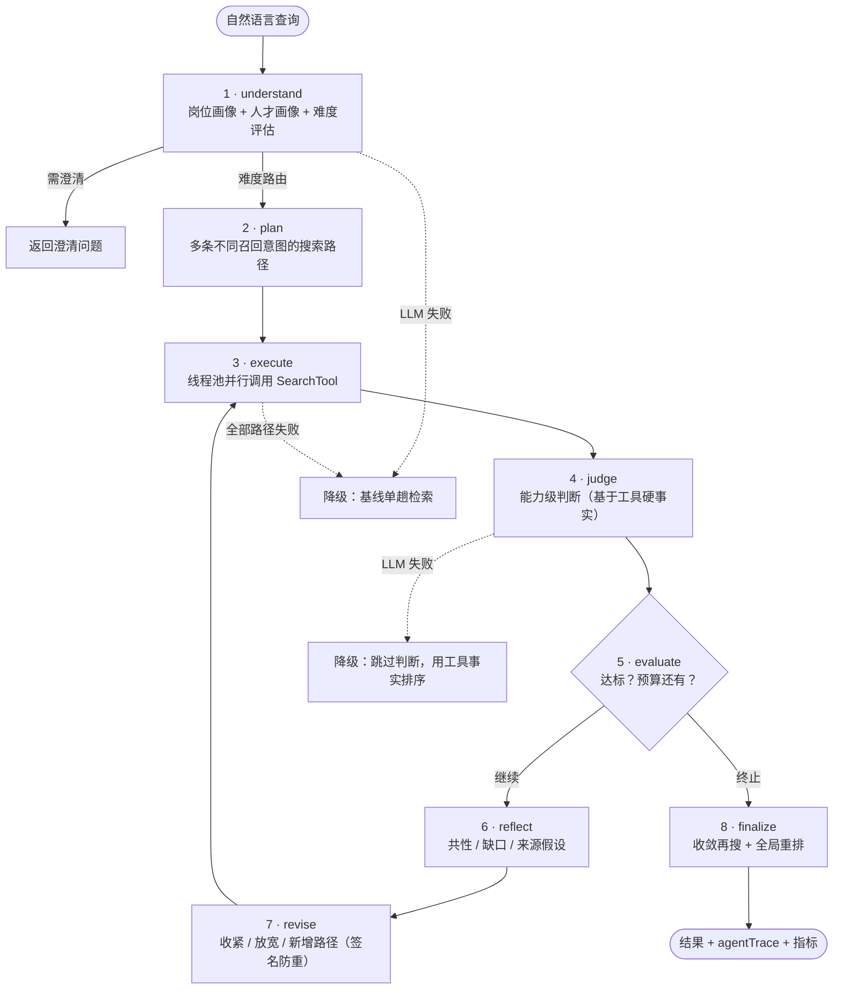

# search-agent-harness

**把「一次检索」升级为「会反思、会自我修正、有预算纪律」的检索 Agent。**

> 一个可嵌入的八阶段检索 Agent Harness（以人才搜索为端到端示例场景）。
> 纯 Python，唯一运行时依赖是 pydantic；自带离线演示，不需要任何 API Key。

[](https://github.com/12wa2/search-agent-harness/actions/workflows/ci.yml)


## 这是什么

传统检索是「一问一答」：解析 → 搜索 → 排序 → 返回。这个项目把它变成一个**推理循环**：

```text
understand → plan → execute → judge → evaluate → reflect → revise → finalize
     ↑                                                                  │
     └──────────── 反思循环（有预算、可降级、防重复）─────────────────────┘
```

在循环里，Agent 会：

- 把自然语言查询拆成 岗位画像 + 人才画像 + 难度评估（不是拿裸 query 直搜）
- 规划多条**不同召回意图**的搜索路径（硬条件精准匹配 / 语义拓宽 / 来源假设 …）
- 用工具返回的事实（而非模型想象）对候选人做能力级判断
- 每轮反思「缺什么」，修订路径再搜，直到达标或预算耗尽
- 全程可降级：任何一步失败都不会让整个请求崩掉

## 亮点（面试可展开讲的部分）
- **显式状态机，不套框架**：8 个阶段各自是 `state in → state out` 的纯函数，`phase` 字段驱动流转；核心逻辑全部可单测（148 个离线测试，另 17 个 ES 集成测试）。同一批阶段还能编译成 LangGraph StateGraph（可选 extra），与默认循环行为等价（有对比测试）。
- **Intent Signature 防重**：搜索意图做规范化 sha1 签名（大小写 / 顺序 / 权重归一），同一意图绝不重复执行——掐死 LLM「换个说法重跑一遍」的烧钱行为。
- **预算是一等公民**：迭代数 / 路径数 / LLM 调用数 / 墙钟时间 4 维预算贯穿循环，5 种显式终止原因（达标 / 迭代上限 / 时间 / 调用预算 / 无进展）。
- **降级矩阵，永不炸**：每个阶段失败都映射到预定义降级动作（返回基线单趟结果 / 降级单路径 / 跳过判断 / 跳过全局重排 / 立即收敛），`degradedReason` 透传到响应。
- **Grounding 防幻觉**：judge 阶段基于检索工具返回的硬事实（hardMatches）做能力判断，prompt 明确「不得编造经历」。
- **收敛再搜**：反思循环把人才画像越描越准，finalize 用进化后的画像做决定性的「最后一发」检索，再做全局重排。
- **并行执行 + 路径质量分级**：多路径用线程池并行调用后端；每条路径产出质量分级（rich / thin / empty）驱动后续策略。
- **可替换检索后端**：`SearchTool` 协议下内置内存参考后端 + SQLite/FTS5 后端（标准库、无需外部服务）；where 树编译成 SQL，两个后端在同一语料上结果逐位一致（跨后端一致性测试钉住）。
- **可观测性内建**：`event_sink` 时间线（下面 demo 里那 8 行）、`agentTrace`、5 组质量指标全部随响应返回。
- **可选持久化**：多轮对话记忆 + 结果分页支持 Redis；不配也能完全无依赖地跑（内存实现兜底）。

## 30 秒上手

```bash
git clone https://github.com/12wa2/search-agent-harness.git
cd search-agent-harness
pip install -e ".[dev]"

search-agent demo        # 离线演示：脚本化 LLM + 16 个合成候选人，零 API key
search-agent eval        # 离线评测：单趟基线 vs Agent 全循环（确定性、可复现）
search-agent serve --offline   # 可选：HTTP 服务（需 pip install -e ".[api]"）
```

接入真实 LLM（任何 OpenAI 兼容端点：OpenAI / Qwen / DeepSeek / vLLM …）：

```bash
pip install -e ".[openai]"
export SEARCH_AGENT_API_KEY=sk-...                       # Windows: $env:SEARCH_AGENT_API_KEY="sk-..."
export SEARCH_AGENT_BASE_URL=https://api.openai.com/v1   # 可选
search-agent search "招聘推荐算法工程师，要求 5 年以上，有召回排序经验"
```

## 运行效果

`search-agent demo` 的实测输出（本机离线运行、纯 CPU、单进程）：

```text
查询 1: 找有 3 年以上经验、做过高并发系统的后端工程师，最好来自大厂
  [1/8 understand] 岗位=后端工程师  必须能力=['高并发系统设计', '服务端开发']  硬条件=1 条
  [2/8 plan] 生成 2 条搜索路径 → p1: 硬条件精准匹配 | p2: 放宽硬条件的语义拓宽路径
  [3/8 execute] 并行执行 2 条路径，召回 30 人次（p1:rich, p2:rich）
  [4/8 judge] 能力级判断完成，累计合格候选人 12
  [5/8 evaluate] → reflect
  [6/8 reflect] 共性=['普遍命中：服务端开发', '普遍命中：高并发系统设计']  缺口=['高并发系统设计']  新增软信号=2
  [7/8 revise] 画像软信号=6  收敛=False  迭代=1
  [8/8 finalize] 最终 10 人（收敛再搜 14 人次）

  共 10 人，展示前 10 人：
   #  姓名       年限     分数  命中能力                           来源
  ------------------------------------------------------------------------------
   1  赵敏        4   3.01  高并发系统设计、服务端开发         硬条件精准匹配
   2  李娜      6.5   2.75  高并发系统设计、服务端开发         硬条件精准匹配
   3  张伟        8   2.59  高并发系统设计、服务端开发         硬条件精准匹配
   ...
  运行指标: LLM 调用 6 次 · 迭代 1 轮 · 召回完成度 0.65（13/20） · 降级=无
  用时 91 ms
```

（演示数据为 16 个虚构候选人；真实模式下同一循环直接对接你自己的检索后端。）

## 评测：单趟基线 vs 全循环

`search-agent eval` 在合成数据上用脚本化 LLM 做**离线确定性**对比：
「单趟基线」（understand → 单条硬条件路径 → judge → 合并重排）与「Agent 全循环」
（八阶段反思循环）跑同一批查询，输出合格候选人数、召回完成度与成本：

| 指标（3 个查询合计） | 单趟基线 | Agent 全循环 | 变化 |
|---|---|---|---|
| 合格候选人 | 25 人 | 36 人 | +11（+44%） |
| 平均召回完成度 | 0.42 | 0.60 | +0.18 |
| LLM 调用次数 | 6 次 | 16 次 | ×2.7 |
| 累计耗时 | 4.7 ms | 8.7 ms | ×1.9 |

> 数字来自本机离线运行，毫秒级会有抖动；重新生成：`search-agent eval --markdown`。
> 目的不是刷分，而是展示**效果与成本的定量权衡**，以及可回归的评测入口。

## HTTP 服务（可选）

```bash
pip install -e ".[api]"
search-agent serve --offline    # http://127.0.0.1:8000；不传 --offline 时按环境变量走真实 LLM
```

| 端点 | 说明 |
|---|---|
| `POST /search` | `SearchRequest` → `SearchResponse`（camelCase JSON；`details=true` 附带 `agentTrace` / `agentMetrics`） |
| `GET /search/stream?query=…&topK=10` | SSE 事件流：每个阶段一帧，最后 `result` 帧返回完整结果 |
| `GET /healthz` | 健康检查：版本 / 模式 / 后端与 LLM 类型 |

```bash
curl -s http://127.0.0.1:8000/search -H "Content-Type: application/json" \
  -d '{"query": "找有 3 年以上经验的后端工程师", "topK": 5}'
```

`create_app(tool=..., llm_client=...)` 同样接受自定义后端，与本地调用共用同一套 `SearchTool` 协议。

## 架构



- 状态机、降级矩阵、预算与合并策略细节：见 `docs/ARCHITECTURE.md`
- 关键设计取舍（ADR 风格）：见 `docs/DECISIONS.md`
- 变更记录：见 `CHANGELOG.md`；贡献指南：见 `CONTRIBUTING.md`

## 项目结构

```text
search-agent-harness/
├── src/search_agent/
│   ├── harness.py           # 外层循环：阶段调度、降级应用、trace 组装
│   ├── service.py           # SearchRequest → SearchResponse 适配层
│   ├── runner.py            # 可替换执行后端（默认 LoopRunner）
│   ├── graph.py             # 可选：LangGraphRunner（同一批阶段 → StateGraph，行为等价）
│   ├── server.py            # 可选：FastAPI HTTP 服务（SSE 阶段事件流）
│   ├── stages/              # 8 个阶段（每个都是纯函数，可独立单测）
│   ├── core/                # 签名 / 合并 / 预算 / 降级 / 难度路由 / 指标 / trace
│   ├── contract/tool.py     # SearchTool 协议 —— 与检索后端的唯一边界
│   ├── tools/memory.py      # 参考实现：内存检索后端（离线演示用）
│   ├── tools/sqlite_fts.py  # 零依赖 SQLite/FTS5 后端（SQL 编译 where 树）
│   ├── tools/text.py        # 共享语义层：分词 / 匹配 / 打分（多后端同源）
│   ├── tools/elasticsearch.py # 真实 ES 8 后端（DSL 编译 + docker compose）
│   ├── llm/                 # LLM 客户端（OpenAI 协议）+ 各阶段 prompt
│   ├── models/              # 意图 IR / 推理工件 / API 模型（pydantic v2）
│   ├── demo.py              # 离线脚本化 LLM + 合成候选人数据
│   ├── eval.py              # 离线评测：单趟基线 vs 全循环（效果 / 成本对比）
│   └── cli.py               # 命令行入口：demo / search / eval / serve
├── tests/                   # 148 离线 + 17 ES 集成
├── examples/                # 接入自定义后端的示例
└── docs/                    # 架构与设计决策文档
└── docker-compose.yml       # 单节点 Elasticsearch 8（端到端示例用）
```

## 接入你自己的检索后端

Harness 与检索后端之间只有一个协议边界：

```python
class SearchTool(Protocol):
    def search_with_intent(self, req: SearchToolRequest) -> SearchToolResult: ...
    def rerank_pool(self, req: RerankToolRequest) -> SearchToolResult: ...
```

实现这两个方法（ES / 向量库 / 内部检索服务皆可），组装
`SearchAgentService(tool=..., llm_client=...)` 即可。参考实现见
`src/search_agent/tools/memory.py`，最小示例见 `examples/custom_backend.py`。
此外仓库内置 SQLite/FTS5 后端（`tools/sqlite_fts.py`，仅标准库）：与内存后端在同一语料上结果逐位一致（见 `tests/test_sqlite_fts.py`）。

## 接入真实后端（Elasticsearch）

仓库自带可直接运行的 Elasticsearch 8 后端（`tools/elasticsearch.py`），与内存参考后端在同一语料上结果逐位一致：

```bash
docker compose up -d elasticsearch   # 单节点 ES 8.15：关闭安全认证，512m 堆
pip install -e ".[es]"
python examples/es_end_to_end.py     # 建索引 → 跑完整 Agent 循环 → 与内存后端逐位比对
```

`WhereNode` 树会先编译成真实的 ES DSL（`terms` / `range` / `bool.must_not` / `minimum_should_match`），`details=True` 时该 DSL 原样出现在 `es_query` 里；引擎侧过滤后用共享语义层复检与打分。集成测试未检测到 ES 时自动跳过（`SEARCH_AGENT_ES_URL` 可覆盖默认地址）：

```bash
pytest -q -m es
```

## 配置

| 环境变量 | 默认 | 说明 |
|---|---|---|
| `SEARCH_AGENT_API_KEY` / `OPENAI_API_KEY` | — | 真实模式必需 |
| `SEARCH_AGENT_BASE_URL` / `OPENAI_BASE_URL` | 官方端点 | 任意 OpenAI 兼容端点 |
| `SEARCH_AGENT_MODEL` | `gpt-4o-mini` | 模型名 |
| `SEARCH_AGENT_MAX_ITERATIONS` | `3` | 反思循环最大迭代数 |
| `SEARCH_AGENT_MAX_PATHS_PER_ITERATION` | `4` | 每轮最大搜索路径数 |
| `SEARCH_AGENT_TARGET_QUALIFIED` | `max(top_k*2, 20)` | 合格候选人目标数 |
| `SEARCH_AGENT_TIME_BUDGET_SEC` | `12.0` | 单次请求墙钟预算（秒） |
| `SEARCH_AGENT_LLM_CALL_BUDGET` | `40` | 单次请求 LLM 调用上限 |
| `SEARCH_AGENT_REDIS_URL` / `REDIS_URL` | — | 可选：会话记忆 / 结果分页 |
| `SEARCH_AGENT_ES_URL` | `http://127.0.0.1:9200` | Elasticsearch 后端地址（`tools/elasticsearch.py`） |

## Roadmap

- [x] 八阶段循环 + 预算 + 降级矩阵 + 并行执行
- [x] 离线演示（脚本化 LLM + 内存后端），零 API key 可跑
- [x] 148 个离线单元测试（+17 个 ES 集成用例）；ruff 全绿；GitHub Actions CI（ruff + pytest）
- [x] LangGraphRunner：把同一批阶段编译成 StateGraph，与默认循环行为等价（可选 extra，见 `graph.py`）
- [x] FastAPI 服务（HTTP + SSE 阶段事件流）：`search-agent serve`（`server.py`，可选 extra）
- [x] 评测脚本：Agent 全循环 vs 单趟 baseline 的效果 / 成本对比（`search-agent eval`）
- [x] SQLite/FTS5 后端（`tools/sqlite_fts.py`，标准库）：where 树编译 SQL + 跨后端一致性测试。
- [ ] Elasticsearch 真实后端 + `docker compose` 端到端示例（ES DSL 编译）。
- [ ] 演示 GIF 与英文文档

## 诚实声明

- 本仓库是**脱敏重构版**：不含任何公司代码、数据或内部文档；演示数据为 16 个虚构候选人（`c001`–`c016`）。
- 生产级检索后端（ES / 向量库）**不在本仓库内**，通过 `SearchTool` 协议对接；仓库内置的内存后端用于离线演示与测试。
- 未在生产环境部署过；上面的耗时数字来自本机离线 demo（纯 CPU、单进程）。

<details>
<summary>English</summary>

An eight-stage reflective retrieval agent harness for talent search:
`understand → plan → execute → judge → evaluate → reflect → revise → finalize`.

Highlights:

- Explicit state machine in pure Python (pydantic v2 is the only required
  dependency); every stage is a `state in → state out` function, unit-testable
  in isolation.
- Budget-governed loop: iterations / paths / LLM calls / wall-clock, with five
  explicit stop reasons.
- Degradation matrix: any stage failure maps to a predefined fallback instead of
  crashing; the reason is surfaced as `degradedReason`.
- Intent signatures deduplicate recall paths; judgments are grounded in
  tool-provided facts (no fabricated experience).
- Optional extras: `openai` (real LLM), `api` (FastAPI `search-agent serve`),
  `langgraph` (`LangGraphRunner`, verified equivalent to the plain loop),
  `redis` (conversation memory / pagination).

Offline runnable without any API key:

```bash
pip install -e ".[dev]"
search-agent demo     # offline showcase: scripted LLM + synthetic candidates
search-agent eval     # single-pass baseline vs the full loop (effect vs cost)
```

See `docs/ARCHITECTURE.md` for the state machine, budget and degradation
design, and `docs/DECISIONS.md` for the ADR-style trade-offs.

</details>

## License

[MIT](LICENSE)
