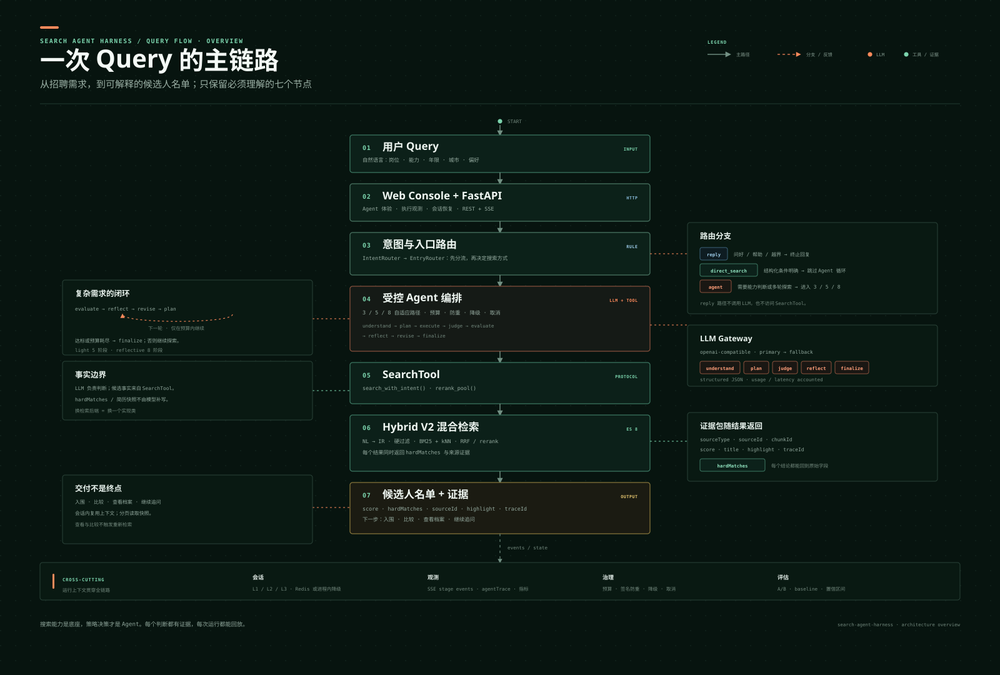
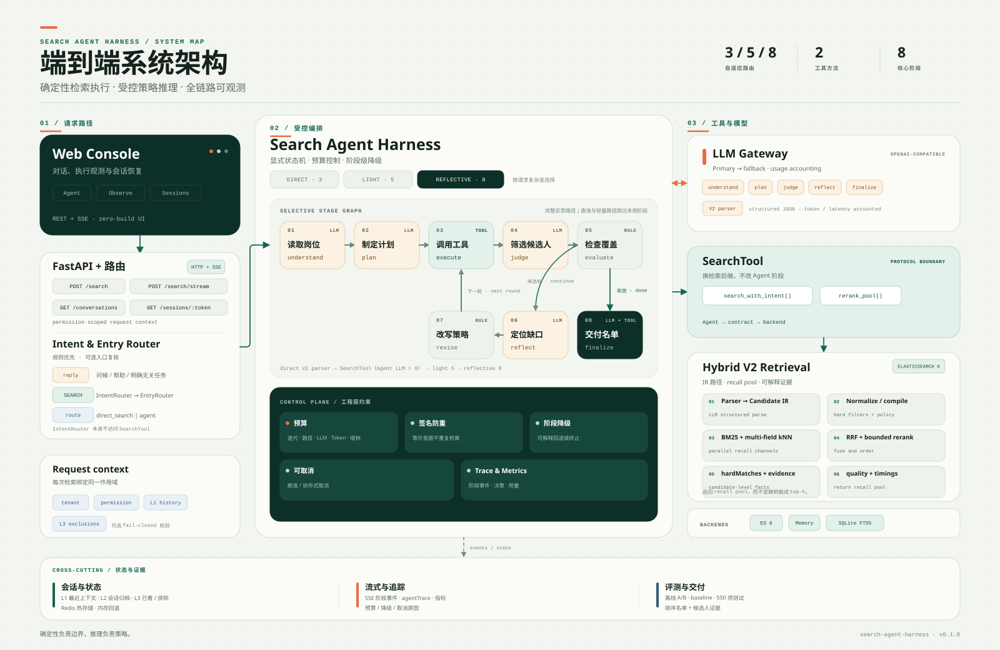
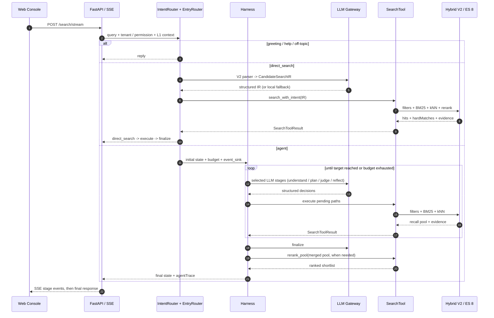

# 架构设计

> 本文说明 search-agent-harness 的运行机制。所有内容与代码一一对应
> （括号中给出对应文件与函数，可直接对照阅读）。

## 0. 系统总览

### 0.1 查询主链路



> 图源：`docs/query-flow.zh.svg`。README 首图展示同一张总览图；本图只保留从 Query 到候选人名单的 7 个核心节点，便于先看整体。

### 0.2 实现架构



> 图源：`docs/architecture.zh.svg`。中英文图由 `node scripts/generate-architecture-svg.mjs` 从同一布局生成；本图保留实现级边界，后续章节进一步拆解状态机、预算、降级、合并和 finalize。

一次复杂请求的端到端时序如下（以 `POST /search/stream` 为例）：



## 1. 设计原则

1. **LLM 只做判断，事实来自工具**。LLM 负责理解意图、规划路径、做能力级判断；
   候选人事实（hardMatches、简历快照）一律来自 `SearchTool` 的返回，prompt 明确禁止编造。
2. **阶段级失败受控、可观测**。已覆盖的阶段级失败走降级矩阵（`core/degrade.py`），
   循环在预算与降级保护下继续或收敛；`degradedReason` 显式透传到响应与 trace。取消是唯一的内部
   控制流异常，在 Harness / Graph 边界被捕获并转为 `cancelled` 终态。
3. **预算是第一公民**。迭代 / 路径 / LLM 调用 / Token / 墙钟预算贯穿整个循环（`core/budget.py`），
   而不是用「超时兜底」处理失控。Token 默认只记账；只有 `max_tokens > 0` 时才启用硬上限。
4. **默认执行路径不依赖 Agent 编排框架**。8 个阶段是纯函数，`LoopRunner` 就是一个显式循环；
   框架接入点通过 `runner.py` 的协议实现：`graph.py` 的 `LangGraphRunner`（可选 extra）把同一批阶段
   编译成 StateGraph，与默认循环行为等价（`tests/test_langgraph_runner.py`），阶段代码不改动。
5. **唯一协议边界**：`contract/tool.py` 的 `SearchTool`。换检索后端 = 换一个实现类。

## 1.1 Harness 之前的请求路由

`IntentRouter` 是 `server.py` 在 `/search/stream` 入口调用的无状态规则层，不依赖 LLM，也不访问 `SearchTool`。它处理问候、身份、帮助和明确无关任务，其余输入默认进入搜索；非搜索请求只发送一帧终止 `reply`，不会消耗模型或检索预算。`POST /search` 保持纯搜索契约。

完整意图表、规则顺序、行业词守卫与示例见 [意图路由](INTENT_ROUTING.md)。

## 2. 完整反思路径的八个阶段

以下八个阶段仅在完整反思路径中执行；直连搜索和轻量 Agent 分别执行 3 阶段与 5 阶段，
具体路由见 1.1 与本节末尾的直连搜索前置路由。

| # | 阶段 | 输入 | 输出 | 依赖 |
|---|------|------|------|------|
| 1 | understand | query（+ 多轮对话历史） | JobProfile + TalentProfile + 难度评估 | LLM |
| 2 | plan | 两个画像 | `list[SearchPath]`（多条不同召回意图） | LLM |
| 3 | execute | pending 路径 | PathResult（并行调用后端，质量分级） | SearchTool |
| 4 | judge | 路径结果 + 岗位能力 | CandidateJudgment（能力级判断） | LLM |
| 5 | evaluate | 累计池 + 路径状态 | 继续 / 收敛（规则，无 LLM） | — |
| 6 | reflect | 路径结果 + top 判断 | Reflection（共性 / 缺口 / 来源假设） | LLM |
| 7 | revise | 反思结果 | 路径动作：收紧 / 放宽 / 新增 / 丢弃 | — |
| 8 | finalize | 全部状态 | 最终排序结果（收敛再搜或合并重排） | LLM + SearchTool |

阶段约定（`stages/base.py` 的 `Deps` 注入 LLM / SearchTool / BudgetState / event_sink / cancel_event）：

- 每个阶段签名统一为 `run_xxx(state, deps) -> dict`，只返回增量更新；
- LLM 相关阶段的解析层都是**宽容解析**：单条坏数据跳过并记日志，不拖垮整个阶段
  （见 understand / plan / judge / reflect 的解析代码）；
- execute 内部的并行只用线程池，状态变更全部留在主线程（`harness.py` 顶部注释）。

### 直连搜索前置路由

`SearchAgentService` 在构造 Harness 之前先调用 `direct_search.py` 做保守判断。只有查询同时满足
“存在招聘搜索信号”和“技能 / 岗位 / 年限 / 城市等明确字段”，且不含
“最好 / 优先 / 可迁移 / 重点考察 / 系统设计”等开放信号时，才会命中直连链路：

```text
自然语言 ──> Hybrid V2 parser LLM ──> CandidateSearchIR
        ──> SearchTool.search_with_intent() ──> normalize / compile / recall / rerank ──> topK
```

这条链路不执行 `understand / plan / judge / reflect / revise`，也不调用 Agent 编排 LLM；
但会调用 `hybrid_v2.parser.parse_query_to_ir()` 生成 IR，因此完整口径是
**Agent LLM = 0，V2 parser LLM ≥ 1**。parser 使用运行时注入的 `LlmClient`：完整在线模式走网关，
快速演示走脚本化客户端。SSE 只发送 `direct_search → execute → finalize` 三帧，
`finalizeReason=direct_search`；工具内部继续完成 normalize、compile、BM25/kNN 召回和重排。

parser 的调用次数、Token、重试与耗时写入 `directSearch.parser`，并映射到
`agentMetrics.meta.agentLlmCalls` / `parserLlmCalls` / `promptTokens` / `completionTokens`。
parser 失败时会重试一次；仍失败则显式回退到本地结构化 IR，标记
`irSource=local_rules_fallback` 和 `degradedReason=hybrid_v2_parse_failed`，不会静默伪装成模型解析。
如果工具启用了 LLM reranker，其成本属于工具侧，不并入 Agent 或 parser 计数。
模糊、偏好重、上下文承接或可迁移能力查询返回 `None`，继续进入下方 Harness。

## 3. 状态机与流转

主循环在 `harness.py::Harness.run`，`phase` 字段驱动，上限 60 步兜底：

```text
（Service 前置）
  明确结构化查询 ──> direct_search ──> execute ──> finalize ──> done
  其余招聘查询   ──> understand ──(need_clarify)──> 返回澄清问题
                         │
                         ├──(简单查询路由)──> single_pass：跳过 plan/reflect/revise，直接执行单路径
                         │
                         v
  plan ──> execute ──> judge ──> evaluate
                                   │
                     ┌─ 未达标且预算允许 ─> reflect ─> revise ─> execute（下一轮）
                     │
                     └─ 达标 / 预算耗尽 ─> finalize ─> done
```

关键分支：

- **难度路由**（`core/difficulty.py`）：understand 产出 `subjective_difficulty` 后立即生效——
  `low → single_pass`（`max_iterations=0`、单路径；evaluate 后跳过反思直接 finalize，
  `finalize_reason=difficulty_single_pass`）、`mid → reduced`（迭代 1、每轮 2 路径）、
  `high → standard`（完整反思循环）。难度衡量的是搜索策略的不确定性，而不是抽取到的
  硬条件数量：简单明确的查询不烧多轮预算，抽象、可迁移或容易漏召的查询才进入反思循环。
  直连链路在 Harness 之前已经拦截“字段充分且无开放偏好”的查询；这里的 `single_pass`
  用于仍需 Agent 理解、但不值得进入完整反思的招聘请求。
- **预算守卫**：非 understand / finalize 阶段发现时间或 LLM 调用超预算，直接跳 finalize
  （`budget_exceeded`）。
- **全路径失败检测**：execute 后若本轮没有任何新 PathResult，判定所有路径失败，
  走 `fallback_baseline`（基线单趟检索）。

### 取消与生命周期

`Deps.cancel_event` 是每次请求独立的协作式取消信号（`core/cancellation.py`）：

- Harness 在进入阶段前、阶段返回后检查信号；`MeteredLlmClient` 在转发给模型前再检查一次。
- 取消不是故障降级：状态记为 `cancelled=true`、`cancelledAt=<阶段>`，
  `degradedReason=cancelled`，trace 保留已完成阶段的证据。
- Service 对取消请求返回空交付集，不把部分候选当成最终结果，也不写策略记忆 / 会话轮次。
- SSE 生成器在客户端断开时于 `finally` 设置信号，释放阻塞中的队列读取。
- 已经在途的模型请求允许返回，不会被强杀；随后停止后续阶段。这是跨 OpenAI / ES / 自定义
  `SearchTool` 都可验证的取消语义，比依赖某个 SDK 的请求中断更稳定。

## 4. 预算与终止

`Budget`（`models/artifacts.py`）包含 **5 类资源预算 + 1 个目标阈值**，默认值来自
`config.budget_from_env`。资源预算分别是迭代次数、搜索路径数、LLM 调用次数、Token 和墙钟时间：

| 字段 | 默认 | 含义 |
|---|---|---|
| `max_iterations` | 3 | 反思循环最大迭代数 |
| `max_paths_per_iteration` | 4 | 每轮最大路径数 |
| `max_llm_calls` | 40 | LLM 调用上限 |
| `max_tokens` | 0 | Token 上限；0 = 只记账不设限 |
| `time_budget_sec` | 12.0 | 墙钟预算（秒） |

目标阈值 `target_qualified` 默认为 `max(top_k*2, 20)`，只用于判定 `target_reached`
和计算路径质量分级，不消耗资源预算。

终止判定集中在 `core/budget.py::should_finalize`，返回 `(finalize, reason)`，
共 6 种原因：`target_reached` / `max_iterations` / `time_budget` / `llm_budget` /
`token_budget` / `no_progress`（没有 pending 路径且本轮无新增合格）。`BudgetState`
同时记录 `llm_calls` / `iteration` / `new_qualified_last_round`，以及
`prompt_tokens + completion_tokens` 的累计 token 用量。

## 5. 降级矩阵

`core/degrade.py` 把 `(阶段, 失败类型)` 映射为 `(动作, degradedReason)`：

| 阶段 | 失败 | 动作 | degradedReason |
|---|---|---|---|
| understand | LLM 失败 | `fallback_baseline`：放弃 Agent，走基线单趟检索 | `understand_failed` |
| understand | 需要澄清 | `finalize_now`：直接返回澄清问题 | `understand_failed` |
| plan | LLM 失败 | `single_path`：用岗位硬条件直接构造单条路径 | `plan_failed_single_path` |
| execute | 全部路径失败 | `fallback_baseline` | `all_paths_failed` |
| judge | LLM 失败 | `skip_judge`：跳过能力判断，用工具事实继续 | `judge_failed` |
| rerank_pool | LLM 失败 | `skip_global_rerank`：按 per-path 分数排序收敛 | `global_rerank_failed` |
| 任意 | 预算耗尽 | `finalize_now` | `budget_exceeded` |

动作语义：`fallback_baseline` = 调用可选注入的基线函数 `fallback_fn`（没注入则返回空结果 +
降级原因）；`single_path` = 用 understand 的硬条件拼一条路径继续；`skip_*` = 用已有事实
继续；`finalize_now` = 立即收敛。Harness 应用失败处理时还会触发一次
`event_sink("degrade:<阶段>", state)`，方便观测。

## 6. Intent Signature（防重复检索）

`core/signature.py::intent_signature`：把搜索意图规范化后做 sha1——

- `where` 布尔树：leaf 只保留 `field / operator / values`（values 去空格、
  casefold、排序）；`and/or` 子节点按规范化 JSON 排序（顺序无关）；
  **有意丢弃** `weight / required / softText`——它们不改变召回域，只影响排序；
- `semantic` 条件按 `(text, fields)` 规范化后排序；
- `meta` 保留 `expandScope / peerHint / tenureIntent`。

同一签名的路径视为「同一次召回」，绝不重复执行：plan 产出的路径与 revise 新增的动作
都会对照 `tried_signatures`（状态里的 set，见 `models/state.py`）。

## 7. 合并与路径质量

跨路径 / 跨轮次的同一候选人（doc_id）在 `core/merge.py::merge_judgment` 中折叠：

- `score`：取 max；
- `matched_abilities`：并集去重；`missing_abilities`：并集后剔除已命中的；
- `hard_matches`：保留更多的一方；`summary`：取分数高的一方；
- `source_path_ids`：来源路径并集（最终结果里"来源"列的出处）。

路径质量分级 `path_quality`：`empty`（召回 0）/ `thin`（合格数 < rich_min）/ `rich`；
`rich_min = max(3, ceil(target_qualified / max_paths_per_iteration))`。
分级结果驱动 evaluate / reflect 的后续策略。

## 8. finalize：两条收敛路径

`stages/finalize.py::run_finalize`：

1. **收敛再搜（画像被反思循环充实过时）**：`where` 只用岗位硬条件（结构性过滤，
   如年限），`semantic` 用全部收敛后的软信号 + 来源假设（按权重取 top 12）——
   让向量召回由最丰富的画像驱动。这是一发决定性检索，随后对新出现、还没判断过的
   候选人做一次批量 judge（grounding 校验，约 1 次 LLM 调用）。
2. **回退路径（未充实 / 单趟 / 降级）**：跨路径合并池 → 全局 `rerank_pool`；
   若 rerank 失败则按 per-path 分数排序（`skip_global_rerank`）。

收尾：不足 `top_k` 时用已判断池补齐；若所有结果都已判断，按「命中 must 能力数、再按分」
做精度排序；最后 `_validate_output` 做输出校验（硬条件违规、负分、空结果异常等，记录 `validationIssues`）。

因此最终交付的 `score` 不是统一概率：直连搜索来自 Hybrid V2 的单次检索/重排结果；复杂链路优先按
`_selection_key` 排序——must 能力覆盖（降序）、缺失 must 能力数（升序）、必需硬条件违规数（升序）、
简历证据覆盖、证据缺口、是否已判断，以及命中能力总数；后端/重排分数仅在这些主信号之后作为次级
tie-breaker。`rerank_pool` 失败时则回退到 per-path 分数。排序分只在同一结果集内有意义，不应跨链路、
跨请求或当作概率/匹配率解释。

## 9. SearchTool 契约

`contract/tool.py`（runtime_checkable Protocol），后端只需实现两个方法：

- `search_with_intent(SearchToolRequest) -> SearchToolResult`：执行一条意图。
  请求携带 `intent`（布尔树 + 语义条件）、`query_text`、`company_id / hr_id /
  permission`、`top_k`、`exclude_doc_ids`（跨轮去重）等；返回 `items`
  （`ToolCandidate`：doc_id、score、`CandidateItem`、`hard_matches`、
  `match_explanation`、耗时）、`total`、`quality`、`timings_ms`。
- `rerank_pool(RerankToolRequest) -> SearchToolResult`：对跨路径合并池做全局重排。

参考实现 `tools/memory.py::InMemorySearchTool` 完整实现了协议（WhereNode 求值、
语义 token 覆盖率打分、hard_matches 计算），用于离线演示与测试。
`hybrid_v2/` 提供第四条可运行路径：IR 归一化 → 硬过滤 DSL → BM25 + 多字段 kNN →
可解释 hardMatches → 本地或有界 LLM 重排。它通过同一协议接入，不改变 Agent 的
3 / 5 / 8 阶段自适应搜索循环；ES 地址、认证、字段名、embedding 和标签字典全部来自环境变量，接入说明见
`docs/HYBRID_V2.md`。

## 10. 可观测性

- **event_sink**：`Deps.event_sink(event, state)` 在每个阶段完成后触发
  （事件名即阶段名），降级时触发 `degrade:<阶段>`；sink 抛异常不影响主流程
  （`harness.py::_emit`）。CLI 的八行时间线就是它的一个实现。
- **agentTrace**：`core/trace.py` 组装，挂到 `SearchResponse.debug.agentTrace`，
  含迭代轨迹、合并池大小、重排是否使用、预算与用量、降级原因、工具调用明细。
- **指标**：`core/metrics.py::collect_metrics` 产出 5 组质量指标——
  召回成功（达标率 / 质量分布）、搜索轮次（每轮新增合格曲线）、匹配质量
  （能力覆盖 / 硬条件命中率）、推理力（来源假设转化）、反思力（每轮反思增益），
  外加 LLM 调用数 / 耗时 / 降级等 meta 信息。

## 11. 扩展点

| 想做什么 | 改哪里 |
|---|---|
| 接自己的检索后端 | 实现 `SearchTool` 两个方法，注入 `SearchAgentService(tool=...)` |
| 换 LLM / 换模型 | 实现 `LlmClient.complete_json`，或配 `SEARCH_AGENT_BASE_URL / MODEL` |
| 换执行后端（LangGraph 等） | 实现 `HarnessRunner.run` 协议；内置 `graph.py` 的 `LangGraphRunner` 可直接用 |
| 调整难度路由策略 | `core/difficulty.py::difficulty_route / adaptive_budget` |
| 调整预算默认值 | 环境变量（见 README「配置」表）或直接构造 `Budget` |
| 调整阶段行为 | `stages/<阶段>.py` 单文件改动，配套测试在 `tests/` |

## 12. 部署形态（容器）

`Dockerfile` 两阶段构建：build 阶段把 `.[api,es,openai]` 解析成 wheel，runtime 阶段只安装 wheel，
以 uid 10001 非 root 运行，内置 `HEALTHCHECK` 打 `/healthz`。

compose 的 `api` 服务等待 `elasticsearch` 和 `gateway` 通过健康检查后才启动，随后先执行
`search-agent hybrid-v2 index --recreate` 把 16 条演示语料灌进 Hybrid V2 索引，再以
`search-agent serve --host 0.0.0.0 --backend hybrid_v2 --offline` 启动快速演示预置并对外提供
HTTP + SSE。配置 `PRIMARY_LLM_API_KEY` 后，compose 会把在线预置接到内部网关；页面按钮可在
同一个进程内切到真实模型 + Hybrid V2。后端统一由 `tools/factory.py` 构造，CLI 的
`--backend memory|sqlite|es|hybrid_v2` 与容器入口走同一条代码路径；`/healthz` 的 `backend`
表示当前生效工具（快速演示为 `InMemorySearchTool`），`onlineBackend` 表示可切换的在线工具。

## 13. 召回层：关键词 / 向量 / 混合（RRF）

`search_with_intent` 保持「引擎侧过滤 → Python 复检与打分」这唯一事实来源，所以内存 / SQLite / ES
三个按相同语义实现的后端逐位
一致；召回层本身在 ES 后端上另开三条通道，供漏斗式检索与演示使用：

| 通道 | 实现 | 说明 |
|---|---|---|
| `search_text` | BM25（`match` on `text_blob`，operator=and） | 关键词召回，可传 `where` 做过滤 |
| `search_semantic` | kNN over `dense_vector`（cosine） | 向量召回，同样支持 `where` filter |
| `hybrid_search` | 两通道各取 `branch_k`，RRF 融合（rank_constant=60） | 生产里常见的召回漏斗 |

向量由 `tools/embedding.py` 生成：确定性哈希词袋 + 次线性 TF + L2 归一化，宽度
`EMBEDDING_DIMS = 256`，必须与索引映射里的 `dense_vector.dims` 一致。它不下载模型、结果可
复现；换成真实 embedding 模型只需替换 `embed_text` 并重建索引，mapping / kNN / RRF 都不用改。
`hybrid_search` 的每一行都保留两条支路的 `rank` / `score`，便于解释某个候选是被哪一路召回的。

## 14. 策略记忆（跨请求）

循环解决「这一次怎么搜」，`core/experience.py` 解决「这类岗位下次先试哪一招」。
存储与会话记忆同构：`ExperienceStore` 未配 Redis 时退化为进程内字典，
读写异常只记日志（策略记忆属增强，不能成为新的故障点）。

数据流三步：

1. **归因**：运行结束后 `attribute_qualified(state)` 把每条真正合格的判断计一次，
   落在它第一来源路径的 `origin`（`plan` / `default` / `fallback` / `loosen` / `tighten` /
   `add_path`，收敛再搜记 `converged`）。
2. **聚合**：按查询族（must 能力名排序后 sha1 取前 12 位）累计
   `runs / qualified / tokens`——族键不含查询原文与候选人数据。
3. **回馈**：plan / reflect 构造 payload 时取 `hints(family)`（按 `avg_qualified` 排序的前 N 条）
   注入 `strategyPriors`；无观测时整键省略，prompt 约定 `runs < 2` 忽略。

工程层只提供证据，决策仍在 LLM；取舍详见 `docs/DECISIONS.md` D23。

## 15. 分层会话记忆与结果分页

这里刻意不引入向量记忆、图记忆或长期用户画像，只保留可过期、可审计的 L1/L2/L3：

| 层级 | 存储 | 保留策略 | 内容与用途 |
|---|---|---|---|
| L1 工作记忆 | 请求状态 + Prompt | 每次请求取最近 3 轮 | 结构化岗位条件、结果数；用于承接“最好有”“不要外包”等追加条件 |
| L2 会话归档 | Redis / 进程内降级 | 30 天，最多 50 轮 | 完整轮次快照：query、摘要、route/status、queryToken、Top 候选人 ID、最多 10 张候选人卡片字段 |
| L3 候选人记忆 | 随 L2 保存 | 同一会话内 | `seenCandidateIds` 记录看过的人，`excludedCandidateIds` 记录招聘者显式排除的人 |

只有显式排除项会传给 `SearchToolRequest.exclude_doc_ids`，并作为复杂链路每轮召回与最终
收敛搜索的过滤条件；服务端还会对最终结果做一次防御性过滤。看过但未排除的候选人不自动
消失，避免一次浏览就永久漏掉合适人选。`seenCandidateIds` 仅用于历史/审计和当前轮内去重，
不会作为后续搜索的排除条件；历史卡片会标注显式排除状态。

`SearchAgentService` 在搜索前按 `conversationId` 加载历史，并按 `(companyId, hrId)` 精确校验归属
（`hrId` 为空也视为独立作用域）。搜索完成后先构建响应，再把同一轮 `queryToken` 与可恢复的
候选人卡片快照写入 L2；新建检索只切换活动 `conversationId`，不删除旧会话。

路由直接回复的问候、身份询问、帮助和范围外说明同样以 `status=reply` 写入 L2，使左侧“最近会话”立即出现
并可恢复；加载历史时会过滤这些轮次，L1 搜索上下文仍只包含实际搜索/澄清轮次。

会话 API 位于静态资源挂载之前：

| 方法与路径 | 用途 |
|---|---|
| `POST /conversations` | 创建一个空会话 |
| `GET /conversations?companyId=&hrId=&limit=&offset=` | 按最近更新时间列出会话摘要 |
| `GET /conversations/{id}?companyId=&hrId=` | 恢复完整轮次与候选人快照 |
| `DELETE /conversations/{id}?companyId=&hrId=` | 删除指定归属的会话 |
| `PATCH /conversations/{id}/candidates/{docId}` | 设置显式排除或恢复候选人 |

结果分页与 L2 分离：`pageSize` 只控制首页切片，后续页通过 `GET /sessions/{queryToken}` 读取，
不重新运行 Agent、不增加 LLM/token 成本。没有 `conversationId` 时由后端生成并返回；没有
`pageSize` 时仍返回完整 `final_items`，且不创建分页 Session。这两条兼容边界让记忆与分页都是
可选增强，而不是主链路的新故障点。
